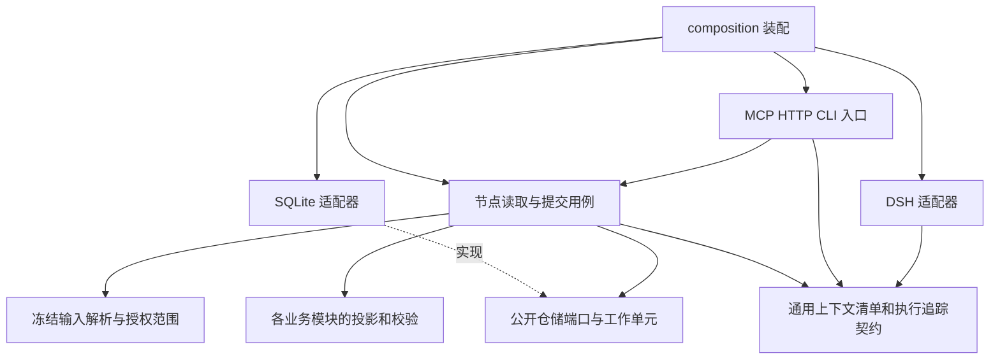
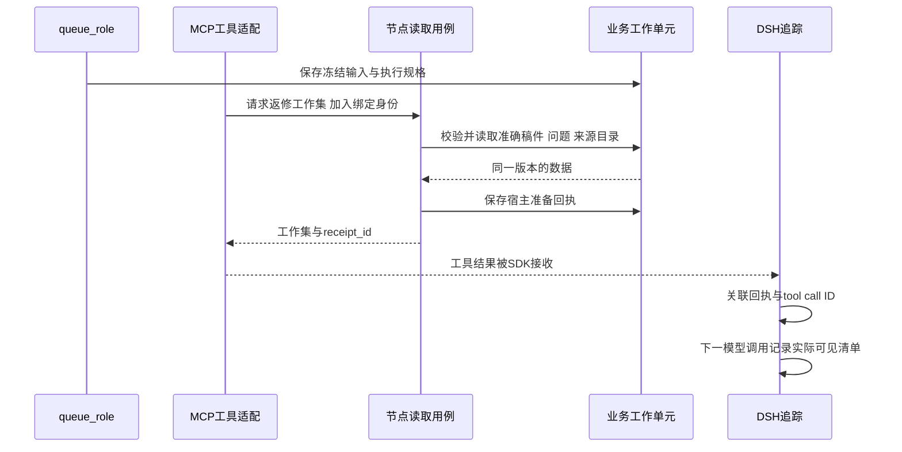

# 采编上下文代码改动方案

当前增量：node-context-v2及revision-window-v1已接入补丁候选、合并保存预检、准确恢复、证据去重/可见代次失效、活动窗口替换、有界摘要和生命周期费用查询；具体实现及限制以[运行契约](production-context-contract.md)为准，下文保留更广的目标设计。
状态：整体代码设计与后续拆分依据。已实现 `node-context-v1` 的节点读取、冻结工具表、来源范围、研究游标、共用问题集合及基础溯源，详见[当前运行契约](production-context-contract.md)。本文的类型表、签名和分批表保留目标设计含义，不表示所有建议文件和接口已建立；短引用与输入引用化仍属后续目标；活动窗口替换及清单查询已按运行契约接入，不能套用本文早期状态说明。

建议采用渐进重构：先分开**任务绑定、节点读取、业务提交、执行观测**，在返修路径完成一条可验证的纵向改造，再覆盖其他节点。首批保留既有业务产物结构和提交校验，不同时重写任务存储、稿件协议和 DSH 会话。

## 1. 改造前代码的真实耦合点

| 位置与核心方法 | 当前职责 | 改动判断 |
|---|---|---|
| `ProductionContext`，位于 `workflows/production_dependencies.py` | 任务输入快照，同时包含稿件、来源、研究与评审；同文件还定义仓储端口 | 保留历史序列化契约；新工作集不再把它当模型 DTO。仓储端口暂不为拆文件而搬迁 |
| `ProductionTask`，位于 `runtime/production_execution.py` | 身份、执行状态、冻结输入、策略标记、已保存研究和读取计数 | 增加可选的契约戳；首批不拆数据库任务行，也不把业务模型导入 runtime |
| `queue_role()` | 继承输入、组合 prompt/资源、选择模型、生成身份、写任务 | 提取“阶段执行规格编译”；排队保留事务和幂等责任 |
| `ProductionWorkbench.context()` | 解码冻结输入，再挂当前底稿、背景和选题资料 | 新路径改为按准确绑定解析；不能继续以整个选题的最新资料集作为任务读取范围 |
| `ProductionWorkbench._reading_source()` | 授权、取资料、读取/定位额度写入 | 拆到专门的绑定来源读取用例，供片段、页窗、定位共同使用 |
| `ProductionAgentTools.get_production_context()` | 一次返回通用模型视图，还计算研究版本、图注等 | 新契约不注册；替换为节点工作集与分项读取。旧任务仍执行现有契约 |
| `revision_reading_view()` | 返修全稿、必改集合、规范正文 | 作为首批收敛入口，直接带轻量来源入口；问题集合与提交校验共用同一解析 |
| `current_writing_research()`、`save_writing_research()` | 解析本任务/继承底稿并保存 | 统一读写游标，明确继承版本和本任务写入版本，见第 4 节 |
| `ProductionHandoff.content()` | 补丁合成、研究/引用/问题校验、新稿与后继原子提交 | 保留业务主干；替换输入解析与问题集合来源，不另写第二套交稿校验 |
| `serve_production_mcp()` | 条件拼接工具列表、选择提交契约、注册观测包装 | 使用冻结的工具配置，按显式 handler 映射注册；服务端权限仍独立检查 |
| `observed_tool()` | MCP 宿主调用起止、参数/返回/异常 | 加入非凭证回执关联及结构化诊断；不能把宿主返回视为模型已收到 |
| `DshExecutionTrace._model_start()/event()` | SDK 可见消息、模型/工具 span、会话状态 | 记录每次模型调用的上下文清单和关联回执；不要重复计算同 span 的多条 started |
| `ProductionAPI.get()`、前端 `ExecutionViewer` | 准确任务详情和通用追踪显示 | 增加只读上下文与诊断投影，沿通用查看器展开；不新增制作专属 trace |

两个必须随改造验证的具体问题：

- `get_production_context()` 的 `writing_research_expected_version` 当前按本任务 history 计算；`save_writing_research()` 却用 `current_writing_research()`，后者可能返回继承底稿版本。继承底稿且本任务尚未保存时，读取与写入可能使用不同版本口径。新契约应从同一游标解析函数取值，旧行为问题另用回归测试证明，不混入无关重构。
- MCP 宿主 `call_id` 当前为自己生成的 UUID，SDK 工具拥有另一套 call ID。现有代码明确不猜配。新增关联需要显式回执，不得按名称、时间或参数相似度回填历史。

## 2. 目标结构与依赖方向



维持[架构检查](../scripts/check_architecture.py)的现有方向：runtime 不导入业务模块或 workflows；infrastructure 不导入 workflows；业务模块不导入基础设施；HTTP/MCP 不直接装配 SQLite。不能把完整 `ProductionInputBinding` 放进 runtime 后让它引用 Story、DraftRevision、ReaderReviewReport。

### 2.1 建议新增或调整的代码位置

以下为规划位置，有实际实现时再建文件；类型按内聚性组合，不按一个类一个文件展开。

| 文件 | 拥有的责任 | 首次引入批次 |
|---|---|---|
| `runtime/context_records.py` | 通用材料指针、清单条目、回执、测量与诊断契约；不含采编业务模型 | A |
| `workflows/production_input_binding.py` | 采编输入类型、冻结输入解析、按契约解析正确版本与任务来源范围 | B |
| `workflows/production_stage_spec.py` | 编译角色/阶段/模式的 prompt、必读资源、工具配置及版本 hash | B |
| `workflows/production_working_sets.py` | 主编、初稿、事实核验、图文的具名工作集组装；复用现有返修/阅读实现 | B/C |
| `workflows/production_source_reads.py` | 来源目录、授权、片段/页窗读取、取证增量登记、额度与回执 | B |
| `modules/content/research_views.py` | 研究条目、骨架段目录与分项纯投影；不执行 SQL | B |
| `modules/review/review_issue_scope.py` | 按准确报告与处置身份解析有效问题集合；纯规则 | B/C |
| `workflows/production_context_reports.py` | 面向后台的绑定、暴露、调用清单和诊断只读投影 | A/D |
| `infrastructure/persistence/sqlite/production_context_repository.py` | 新上下文清单/回执的实际持久化；按中性 runtime 契约实现端口 | D，确有持久化需要时 |
| 现有 `revision_context.py`、`reader_editing.py` | 保留返修专用投影和阅读分步门禁，调整依赖而非机械迁移 | B/C |

`ProductionAgentTools` 保留为 MCP 绑定适配器，构造时直接注入读取用例、提交用例和非凭证调用身份提供器；新增能力不再要求向 `ProductionWorkbench` 追加同名转发方法。`ProductionWorkbench` 已有启动、查询和执行编排仍保留。提取旧读取实现时逐步更新真实调用者，删除无行为的中间转发，不保留永久两套调用链。

## 3. 核心数据结构

### 3.1 通用契约与业务契约分层

| 类型 | 建议位置 | 核心字段与不变量 |
|---|---|---|
| `ContextContractStamp` | runtime | context_version、tool_profile_version/hash、projection_version、prompt/resource hash；不携带业务正文 |
| `ArtifactPointer` | runtime | namespace、record_id、revision、content_hash；用于准确指向，namespace 来自注册表，不能作为任意数据库表名 |
| `ContentRange` | runtime | coordinate_system、start/end、可选 page/block；区间半开，坐标体系明确，不能混用 Python 字符偏移和前端 UTF-16 |
| `ContextManifestItem` | runtime | item_id、artifact_pointer、range、role/category、inclusion_reason_code、disposition、payload_path、公开内容 hash、尺寸 |
| `ContextManifest` | runtime | manifest_id、task/attempt/session、contract stamp、items、message refs、complete、missing_reason；不嵌整份正文 |
| `ContextReceipt` | runtime | receipt_id、manifest_id、host_call_ref、result_hash、covered_ranges、continuation；非凭证，不能用作授权 |
| `ContextDiagnostic` | runtime | code、severity、scope、related_refs、safe_detail、recoverable、suggested_action；技术问题与业务评审问题分开 |
| `ProductionInputBinding` | workflows | 准确候选/任务书/稿件/报告/图文引用或冻结副本、来源允许集合、继承研究引用、phase/mode；业务 union 在此解析 |
| `ResearchReadCursor` | content/workflows | inherited_ref、current_ref、write_expected_revision、task_local_revision、origin_task_ref；读写方法共用 |
| `ActiveIssueSet` | review | 准确报告 refs、必改项、已关闭/撤销身份、required_response_ids、scope_hash；供模型投影和提交校验共同使用 |
| `SourceCatalogPage` | materials | items、cursor、has_more、scope_hash；无来源正文和全量 locator 列表 |
| `RevisionWorkingSet` 等具名类型 | workflows/现有专用文件 | 完整当前稿、有效问题、轻量主张索引、来源入口、规范及版本/预算回执；不继承通用全字段模型 |

新类型采用 Pydantic 外部边界、内部按需 frozen dataclass。沿现有老接口的历史 dict 不在本次顺手全量迁移；新增结构不使用 `dict[str, Any]`。模型生成的“读取原因”可作为独立的 untrusted purpose 文本，宿主 `inclusion_reason_code` 必须由实际投影规则产生，不能把模型解释当程序事实。

### 3.2 ProductionTask 的最小调整

首批仅添加可选 `context_contract` 和必要的来源增量/绑定标识。缺失字段表示既有契约，不能填当前默认值。`input_json` 仍是完整可恢复的冻结输入，`writing_research_json` 等现有保存字段暂留。

这样先解决“模型看到什么”，不同时要求迁移全部历史内嵌 JSON。目标输入引用化分两步：

1. 新读取路径在现有冻结快照上建立准确 `ProductionInputBinding`，来源补读通过授权增量登记，禁止无条件并入同选题最新证据。
2. 确有体积/性能收益并完成不可变版本验证后，新根任务改存具名引用。没有不可变版本的材料继续保留副本；旧任务不回填、不重算 hash。

绑定解码器是契约分派，不是通用兼容门面。入口只有 `decode_bound_input(task)`；内部按明确版本调用现有解码或新类型解析。未知版本必须报错，禁止“解析失败就尝试最新格式”。

### 3.3 模型工作集与后台报告必须分型

`RevisionWorkingSet` 是允许暴露给模型的 DTO；`ProductionContextReport` 是人工诊断 DTO。两者不互相复用。后台可以展示 H 项为何未进入模型，模型工具则不能获得 H 项正文或 X 项身份明细。

`ContextManifest` 也分宿主完整清单和模型简短回执：完整清单不随每次工具结果全部返回。模型通常只需 receipt_id、对象版本、有效范围和续读入口，避免为了记录溯源再次扩大上下文。

## 4. 核心方法调整

以下签名表达目标契约，省略构造参数的细节，不是本轮新增的可执行 API。

### 4.1 排队与执行规格

```python
compile_stage_spec(definition, phase, mode, frozen_parent_policy) -> StageExecutionSpec
freeze_input(context, stage_spec, source_scope) -> ProductionInputBinding
queue_role(work, definitions, role, context, limits) -> ProductionTask
```

`StageExecutionSpec` 包含 prompt、required_resources、tool_profile、契约戳和模型配置，编译只做确定性组合，不开数据库、不联网、不初始化 SDK。发布资源由调用者读取后传入。

`queue_role()` 保留现有工作单元：核对父任务及 auto_run → 继承允许的策略 → 编译规格 → 冻结输入 → 计算准确身份 → 幂等读取/创建。身份计算包含新契约戳，新字段缺省时旧算法不变。首次 rollout 只允许新根任务启用新规格，不能在旧父任务的后继中自动换上新读取协议。

`stage_spec` 是工具注册和系统 prompt 的共同来源，消除“提示词说一次最多三次，运行配置实际只有两次”等跨层手写分歧。资源文本保持独立冻结，不能把每份规范重复拼入 prompt。

### 4.2 节点读取

```python
load_revision_working_set(request: BoundTaskRequest) -> RevisionWorkingSet
list_task_sources(request: BoundTaskRequest, query: SourceCatalogQuery) -> SourceCatalogPage
read_research_item(request: BoundTaskRequest, query: ResearchItemQuery) -> ResearchItemView
read_review_issue(request: BoundTaskRequest, query: ReviewIssueQuery) -> ReviewIssueView
read_task_checkpoint(request: BoundTaskRequest) -> TaskCheckpointView
```

`BoundTaskRequest` 的任务、尝试和租约从绑定 MCP 会话注入，不让模型选任意 task_id 或提交租约。方法逐一声明可读阶段和材料，不能用一个 `get_context(fields=...)` 重新提供所有数据。

`load_revision_working_set` 使用一个短工作单元：验证租约/业务版本 → 解析准确绑定 → 计算有效问题 → 读取稿件与目录 → 构建视图 → 登记实际交付的必读规范及宿主准备回执。无网络。未准备成功不能把规范记为已交付。SDK 送达状态另由追踪确认。

纯列表查询使用 query_only 读取；涉及读取额度或 skill_reads 变更的工具仍使用短写事务。工具名叫 get 不等于完全无持久化副作用，公开方法 docstring 必须说明。

### 4.3 来源读取与增量

```python
resolve_authorized_source(work, binding, source_ref) -> BoundSource
reserve_source_read(work, request, read_key) -> ReadReservation
read_document_window(bound_document, window) -> DocumentReadResult
commit_source_read(work, reservation, result) -> SourceReadReceipt
```

从 `_reading_source()`、`read_evidence()`、`read_document()` 中按实际职责提取，而不是各工具复制一套授权。

执行步骤：短事务中验证绑定/预算并预留读取 → 事务外解析或网络 → 新短事务核对同一租约和版本 → 保存授权来源增量、准确窗口及结果。暂停/停止后晚到结果不交给模型、不修改有效保存点；已发生尝试和费用保留。失败预留如何计次沿冻结策略，不能为了重试把计数清零。

缓存命中只减少外部工作，不自动扩大来源权限。已有来源 text hash 必须一致；PDF 按 SHA 与解析版本校验。写入来源仍走当前 `DraftRepository`/资料公开能力，不从工作流直接更新 `content_evidence`。

### 4.4 研究版本与保存

```python
resolve_research_cursor(task, binding, kind) -> ResearchReadCursor
save_writing_research(work, request, result, expected_revision) -> ResearchSaveReceipt
```

新契约选定**本任务本地修订号**作为写入 CAS：没有本地保存时为 0；继承底稿版本单独放在 `inherited_ref`。首次实质修改保存为本任务第 1 版，并记录 base_ref；不复制继承版本号当作本地 expected_revision。

同内容幂等返回已有准确引用，回执同时返回下一次写入应使用的 revision。模型不能从展示版本号自行计算下一版。列表、分项读取、保存回执和校验错误都调用同一个游标解析，避免口径漂移。

技术重试的新任务把上次已提交研究作为显式恢复来源，保留来源任务身份；不能把前任务的历史数组当作新任务已写入的记录却仍标新任务创建。旧冻结契约维持旧语义，新本地修订语义通过版本分派实施并覆盖继承/重试测试。

### 4.5 有效问题与提交

```python
resolve_active_issue_set(reports, dispositions, bound_draft) -> ActiveIssueSet
validate_revision_responses(submission, active_issues) -> None
apply_draft_revision(base, submission) -> DraftSubmission
```

`revision_reading_view()` 和 `ProductionHandoff.content()` 共用 `resolve_active_issue_set`。首批抽取现有行为并证明结果等价；后续问题关闭/撤销规则只在新契约完善，不能在抽取时把历史必改悄悄删掉。

问题身份使用 `(report_ref, issue_id)`，跨轮持续问题另有明确 carried_from 关系；同名 R1 不自动认定相同。作者回应不是关闭动作。后续有权限的评审显式关闭/撤销，保留原因与准确稿件版本。

`content()` 继续负责：校验租约 → 合成准确新稿 → 核对研究与引用 → 核对全部有效必改回应 → 保存新稿、推进版本、排后继、完成任务，全部在同一短事务。这里不引入网络、模型或新独立 commit。

### 4.6 技术重试与冻结输入

`ProductionExecution.control()` 新路径应调用 `restore_task_binding(original)`，只变化明确允许变化的身份、父子关联、尝试、租约、当前会话读取记录和恢复来源。保留模型、策略、额度、原材料版本。

不要再通过“解码旧上下文后用当前默认序列化”重建原输入：当前 `control()` 会重序列化 `ProductionContext`，已有默认字段被重新带出的风险。使用契约专属的最小字段变更，并用序列化字节/语义快照测试明确允许的差异。

## 5. 新能力如何嵌入现有调用链



`composition.build_production_workbench()` 继续是具体依赖装配入口，可返回明确的应用组件集合供 MCP/HTTP 选择，不新增一个包罗所有方法的服务。业务用例通过 Protocol 接收查询、事务工厂、读取器和观测写入器。

MCP handler 显式映射到具名方法。需要变更的核心注册由 `resolve_tool_handlers(stage_spec, services)` 完成，未知 profile/name 拒绝；不从模型输入 `getattr`，不提供任意方法执行器。历史 profile 使用现有注册逻辑，不重新恢复已删除的旧入口。

新节点接口默认返回业务 DTO 加一个很小的回执字段。读取器内部可生成丰富 manifest，但不把整个 manifest 再传给模型。现有保存工具优先保持简短回执，与当前 compact_receipts 行为衔接。

## 6. 上下文溯源设计

### 6.1 需要贯通的六层身份

`业务产物版本 → 任务输入绑定 → 工作集及范围 → 宿主工具回执 → SDK 工具结果 → 具体模型调用`。

每层都有独立身份，不拿 task_id 代替所有身份。底稿条目来源指向准确版本及条目路径；来源文本指向 hash 与实际窗口；问题指向准确报告。模型调用沿现有 trace_id/span_id/turn/step/call_id。

| 状态 | 可以声称什么 | 不能声称什么 |
|---|---|---|
| `assembled` | 宿主完成工作集构建 | 模型已收到 |
| `host_return_ready` | 宿主准备了该准确工具返回 | SDK 已接收或供应商已看见 |
| `sdk_result_observed` | SDK 事件里出现匹配回执及结果 | 后续请求一定携带它 |
| `included_in_model_context` | 某个具体模型调用的 SDK 可见消息含它 | 原始 HTTP 报文一致、模型理解或接受了它 |
| `replaced_or_compacted` | SDK 明确报告替换/压缩的消息范围 | 被替换内容已转为有效研究保存点 |
| `unknown` | 当前证据不足 | 按相邻时间猜测送达或删除 |

追踪状态使用不可变事件追加，不覆盖旧事件“升级证据”。前端可以投影最新已证实状态，保留各阶段原始依据。

### 6.2 MCP 与 SDK 的显式关联

首版在新工具的返回 DTO 中加入非凭证 `receipt_id`，并记录对应 host_call_ref、task、attempt、session、manifest_id 和脱敏结果 hash。`DshExecutionTrace` 只在 SDK 实际 `tool/result` 中解析此受控字段，验证它属于本任务/会话，再追加 host↔SDK 关联事件。

不要只依赖 MCP `_meta` 是否穿透 SDK；必须先做契约探针。若最终确认 `_meta` 稳定保留，可在新传输版本中迁移，不能仅凭文档假设它可见。未知或模型文本中伪造的 receipt_id 不创建可信映射。

结果 hash 使用带版本的规范化规则：对业务 DTO 做稳定序列化，排除回执字段本身，避免循环依赖；不能直接比较传输层 JSON 的空白或键顺序。只有受信任的 SDK 工具结果事件、已持久化的回执身份和匹配的业务载荷同时成立，才确认关联。SDK 若改变载荷且无法可靠还原，标记关联证据不足，不放宽为任意文本包含回执号。

`observed_tool()` 已创建每次宿主调用 UUID。规划将其作为 runtime `ToolInvocationRef` 在包装器作用域提供；MCP handler 取得后显式传给应用用例。若用 ContextVar 传递包装器作用域，必须限定入口内部、异步隔离并 finally reset；业务服务仍接收显式参数，不依赖隐式全局上下文。

旧事件缺显式回执时继续显示未关联；不依据工具名、时间、JSON 相似度追认因果关系。同一回执出现多次可记录重复交付，不能重复执行保存操作。

### 6.3 每次模型调用的清单

在 `DshExecutionTrace._model_start()` 观察到足够 request/header 与实际消息后，生成规范化清单 hash。条目分别计系统规则、工具 schema、入场工作集、原文窗口、研究/问题分项和历史公开响应。保留原消息 seq 与 source，不遍历被省略的隐藏推理。

现有同一 span 可能多次发 started：以 `(span_id, manifest_hash)` 去重记录清单，内容确实更新则追加 manifest revision。请求次数和费用仍以 SDK/供应商用量契约计算，不能数 started 行数。

清单提供覆盖度：完整、部分、载荷截断、无法关联。`bounded_observation_json` 当前可能保留 preview；只剩 preview 时不得从它构造“完整输入”。材料大小记录 UTF-8 字节/明确字符体系，token 估计注明方法；无法拆分供应商总 token 到材料时不编造精确占比。

原文支持关系和上下文暴露关系分别保留：被送入模型的来源未必被稿件引用；稿件引用的旧证据未必在本次尝试重新发送。不能把两张关系图合成“模型已核实”。

### 6.4 持久化与原子性

首批复用 `workflow_observations`，通过具名 Pydantic payload 记录 `context_manifest`、`context_delivery`、`context_diagnostic` 操作。`ExecutionIdentity.kind` 继续使用已有 event/tool/model，不为了业务名增加一套树。

对于规范已读标记、授权来源增量和恢复引用这类影响业务的状态，不能只写到观测日志。它们必须与相应状态修改在同一工作单元提交。新 `work.observations.append()` 可使用同一 SQLite 连接的观测写入实现；不要在持有 `BEGIN IMMEDIATE` 时调用当前另开连接的 `ObservationRepository.append()`，避免锁等待和半提交。

宿主准备回执在工具返回前持久化；保存失败则不把该返回交给模型。SDK 观测在事务外独立写入，失败标记 telemetry_incomplete 并让读取去重采取保守行为。若业务产物已提交，观测失败不能反转业务成功或触发重复提交；报告需区分“业务成功，追踪不完整”。

有业务写入的工具应把业务产物与必要的宿主准备回执放在同一事务：任一写入失败整体回滚；提交后的补充观测失败只影响追踪完整性。只读工具则在结束读取事务后保存回执，回执保存失败可明确返回读取失败。避免出现业务已成功提交、仅因后置回执失败却向模型报告可重试的业务失败。

不要把未脱敏大消息另存一份来规避观测截断。将清单按条目分页事件保存，每片保留统一 manifest_id、part_index/count 和完整性状态。只有实际性能与查询需求证明必要，才引入专用 manifest 索引表；原始 trace 仍是同一体系。

短引用映射和不可变输入引用化是业务恢复所需，后续需要专用持久记录时由执行数据仓储持有，并加入 ProductionUnit 端口。基础设施只接收 runtime 的中性记录，不导入 workflows 的业务 union。迁移使用实施时下一个可用编号，不在计划中预占 v14。

## 7. 问题暴露与诊断窗口

### 7.1 稳定诊断码

| 代码 | 触发依据 | 对模型/操作员的处理 |
|---|---|---|
| `CONTEXT_SCOPE_DENIED` | 请求来源不在准确任务允许集合或节点被禁止 | 拒绝，不返回其他任务材料；给当前允许入口 |
| `CONTEXT_VERSION_MISMATCH` | 稿件、研究、规范或来源 hash 不符 | 明确冲突对象和当前可恢复入口，不自动换最新版 |
| `CONTEXT_REQUIRED_ITEM_MISSING` | 必要稿件/问题/规则未能组装 | 不启动残缺评审；保留缺项身份 |
| `CONTEXT_DUPLICATE_PAYLOAD` | 同版产物或相同范围重复出现 | 观测提示，不默认中止；标记是否显式重读 |
| `CONTEXT_PAYLOAD_TRUNCATED` | 真实返回或追踪存储截断 | 显示覆盖范围及续读；追踪截断不能冒充模型收到的内容被截断 |
| `CONTEXT_RECEIPT_UNLINKED` | 有宿主回执但无 SDK 关联证据 | 状态未知，不按时间匹配 |
| `CONTEXT_MANIFEST_INCOMPLETE` | 消息替换缺 seq、清单缺片或观测丢失 | 停用基于该清单的省略优化，保留显式重读能力 |
| `RESEARCH_REVISION_CONFLICT` | 与统一写游标不匹配 | 返回 write_expected_revision 和准确 current_ref，不回显全底稿 |
| `REVIEW_SCOPE_CONFLICT` | 必改范围与提交冻结 scope_hash 不匹配 | 拒绝静默更新要求，重新取得准确工作集 |
| `MODEL_OUTPUT_LIMIT` | 明确 max-tokens | 技术失败，不推断隐藏推理原因，不自动扩额 |
| `MODEL_PROVIDER_SERVER` / `MODEL_STREAM_CLOSED` | 明确供应商结构化结束代码 | 保留既有安全分类；业务未提交与已提交后晚到错误区分 |

事实/阅读评审问题仍使用原业务报告及 issue ID，不塞进 `ContextDiagnostic`。新增诊断码表达程序可证明的事实；“无效思考”“模型绕圈”不作为确定性诊断码。

### 7.2 三个对外读取窗口

建议在准确任务范围下增加只读 API，由 `production_context_reports.py` 提供用例，HTTP 只做参数解析：

| 路由草案 | 返回 |
|---|---|
| `GET /api/production/tasks/{id}/context-summary?attempt=...` | 冻结契约、工作集、材料分类大小、N/D/H/X 处理摘要、完整性与诊断计数；不拉全消息 |
| `GET /api/production/tasks/{id}/context-manifests?attempt=...&after=...` | 分页清单头；可按 model span 定位；游标使用真实持久序列 |
| `GET /api/production/tasks/{id}/context-manifests/{manifest_id}` | 来源/产物身份、窗口、为何进入、宿主/SDK关联、准确模型调用与可展开内容引用 |

诊断明细可复用 observations 的按 operation 分页，不额外新增一条全量日志接口。接口不得接受任意文件路径；对 manifest_id 验证所属 task 和 attempt，不能凭 ID 绕过范围。

`context-summary` 必须用 `page/read_observations` 迭代，不能直接调用当前 `ObservationRepository.list()` 的前 1000 条限制后称为完整统计。页面摘要是可重建投影，缓存以最后观测序号和准确任务版本失效。

前端在现有“输入”和“执行记录”中提供：查看本节点绑定 → 查看本次调用实际包含 → 点开来源窗口/相关问题 → 查看诊断和恢复动作。默认只呈现摘要，原始 JSON 仍按需展开。`execution-model.js` 继续以明确 span 归并，不把多个 manifest revision 覆盖成无法查看的单个最新 input。

增加通用 `execution-context` 展示组件时只消费通用 manifest DTO；采编中文标签放现有业务标签文件，不在组件里写“writer/reviewer”分支。筛选、展开和返回保留 task、attempt、span 的 URL 定位，不为查看诊断请求模型。

### 7.3 内部调试窗口

为开发保留一个离线用例 `inspect_task_context(task_id, attempt, span_id)`：从存量准确记录构建清单、输出分类尺寸/重复覆盖/未知状态，不创建任务、不领取租约、不调用模型。可通过维护脚本调用同一报告用例，禁止脚本自行 SQL 拼接另一套分析。

核心断言可直接调用纯投影和 `resolve_active_issue_set`，不需要启动 MCP/DSH。配对探针则用离线 Harness 事件替身验证真实结构；真实 SDK 冒烟另行授权，不拿 fixture 宣称供应商兼容。

## 8. 分批改动与依赖

| 批次 | 核心改动 | 涉及的既有文件 | 验收与可独立回退边界 |
|---|---|---|---|
| A 只读基线与观测契约 | manifest/diagnostic 类型、离线报告、分页统计 | execution_trace、workflow_observation、context reports、观察仓储查询 | 不改模型行为；历史只做证据允许的投影，缺失关联为未知 |
| B 返修纵向实现 | stage spec/绑定解析、来源与研究分项、统一研究游标、返修入口、工具配置 | production_queue、production_agent_tools、revision_context、production_workbench、production_tasks、production_server、composition | 新任务显式启用；目录读取不回传稿件；提交结果与原校验一致；旧任务不变 |
| C 其余节点与问题范围 | 节点具名投影、共用 ActiveIssueSet、盲读与图文权限 | production_reading_view、reader_editing、production_handoff、article_editing 等 | 各节点 N/D/H/X 矩阵和业务后继正确；不能关闭未解决问题 |
| D 可信暴露关联与查看器 | receipt 贯通、逐调用 manifest、准备/送达状态、只读 API 和诊断显示 | observed_tools、dsh_execution_trace、production_api、execution-model/viewer/labels | 同名并发工具、失败和压缩不误配；观测失败不改变已提交结果 |
| E 短引用与输入引用化 | ref 映射、不可变存储、准确补丁传输适配 | draft_revision、资料查询、task/repository/unit、迁移 | 与长引用等价；跨任务/旧版本拒绝；恢复、备份和引用保护通过 |
| F 会话裁剪与预算 | SDK 能力探针后再实现替换/重取 | patch、production_runner、dsh_execution_trace | 不丢失必要稿件或证据；模型质量与成本对照通过后才默认启用 |

B 可使用 A 的宿主级 manifest，D 再补 SDK 关联；在 D 完成前只显示“宿主准备返回”，不提前标成“模型收到”。E 不阻塞 B：首批沿用准确长 ID/hash/span，先消除整包材料。F 不阻塞其他批次，SDK 能力不满足时停留在有界读取方案。

每批提交应保持一个可解释的变化原因：先抽取并保持行为，再启用新契约，再扩展诊断。不要一次提交中同时升级技能正文、改变模型、变更输出额度并重写持久化，否则无法定位质量变化来源。

## 9. 测试和交付标准

| 层次 | 需要覆盖的实质场景 |
|---|---|
| 纯函数/契约 | 各节点投影没有 H/X 正文；短目录不嵌全文；有效问题集合和提交要求完全一致；稳定规范组合；类型序列化 |
| 研究版本 | 无继承首次保存、继承后首次修改、同内容幂等、本地多版、技术重试恢复、并发冲突；读回游标一定能用于下一次合法保存 |
| 权限与来源 | 猜中其他任务 ID、同选题晚新增资料、PDF 同页不同 SHA、旧 span、变更后的草稿；目录/恢复接口不能绕过阅读盲读 |
| 事务与晚到结果 | 暂停时取证返回、提交成功后观测失败、准备回执写入失败、来源增量写入失败；不半提交、不重复推进 |
| 追踪关联 | 同名同参并发工具、重发回执、伪造回执、SDK 没收到结果、多个 started、消息替换缺 seq、超过 1000 条观测、清单分片缺失 |
| 内容正确性 | 表达小修、整体结构调整、新增/删除主张、引文歧义、图注与准确图像、未解决问题；不能为了省 token 放松校验 |
| 旧任务与升级 | 默认字段省略保持、旧契约读写、根任务切新策略、后继与重试不静默升级、未知契约拒绝、迁移备份与恢复 |
| 前端只读 | task/attempt/span 定位保留、分页合并去重、未知状态可见、失败可下钻、展开不重复加载整包、不触发模型 |

代码改动后按仓库规定执行 Ruff、格式、架构和完整 pytest；前端变更再执行对应现有测试与构建。业务行为与代码架构文档同步，正式选择生效时更新对应 ADR。纯设计文档检查链接、结构和契约一致性；行为修改必须增加相应回归，不以离线测试冒充真实模型运行。

真实验证先固定同一材料、模型和规则比较新旧工作集，再分别评估短引用与推理策略。接受标准同时覆盖正确性、可读性、合法提交率、输出触顶、成本和时延。仅降低 token 不足以通过发布。

## 10. 首批实施建议

先实现 **A＋B 的最小纵向范围**：统一研究游标，新增来源目录/研究分项读取，返修入口直接提供所需来源入口，给新任务冻结工具配置并移除总上下文工具，同时记录宿主级 manifest 和结构化诊断。

这批应能直接证明：模型为了查主论文或一个研究结论，不再重新取得整稿、整份底稿与全部评审；新稿仍走原有完整校验；任何暴露内容可以定位到准确产物、范围和调用回执。随后做 C/D，把同一套规则扩展到其他节点并形成可操作的诊断界面。

参考实现入口：[工作台](../src/agent4pharma/workflows/production_workbench.py)、[模型工具](../src/agent4pharma/workflows/production_agent_tools.py)、[返修投影](../src/agent4pharma/workflows/revision_context.py)、[交接](../src/agent4pharma/workflows/production_handoff.py)、[研究保存](../src/agent4pharma/workflows/writing_research.py)、[MCP 观测](../src/agent4pharma/entrypoints/mcp/observed_tools.py)、[DSH 追踪](../src/agent4pharma/infrastructure/llm/dsh_execution_trace.py)、[持久化工作单元](../src/agent4pharma/infrastructure/persistence/sqlite/production_unit.py)、[通用查看器](../frontend/src/execution-viewer.jsx)。
