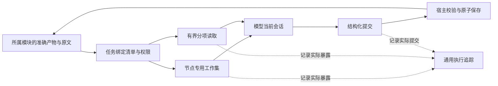
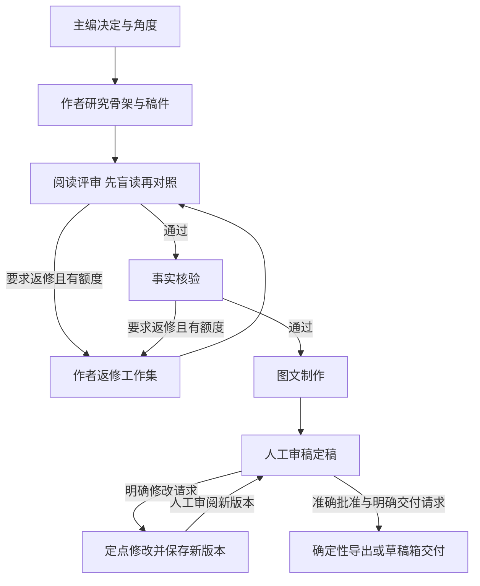

# 采编节点上下文整体设计与详细方案

当前增量：node-context-v2及revision-window-v1已接入补丁候选、合并保存预检、准确恢复、证据去重/可见代次失效、活动窗口替换、有界摘要和生命周期费用查询；具体实现及限制以[运行契约](production-context-contract.md)为准，下文保留更广的目标设计。
状态：整体目标设计。节点工作集、按需读取、任务来源范围、研究游标及基础溯源已按 `node-context-v1` 接入，准确生效范围和未启用能力以[当前运行契约](production-context-contract.md)为准。本文覆盖上游筛选与下游人工定稿的完整目标；未在运行契约列出的接口、预算目标、短引用和会话裁剪不代表已经接入。历史冻结任务不自动迁移。

核心选择：**业务资料按准确版本保存在所属模块；任务绑定资料及权限；模型按节点获得专用工作集，再按具体问题读取补充资料。** 下游接收结构化产物及其来源引用，不继承上游聊天记录。完整留档、允许访问、实际送入模型是三种不同状态。

对应的类型拆分、方法调整、调用链、溯源与诊断落点见[代码改动方案](production-context-code-plan.md)。

## 1. 问题与设计取舍

### 1.1 改造前已确认的问题

当前已有目录投影、返修专用工作集、盲读隔离、局部改稿与冻结配置，不需要重新搭建一套 Agent 框架。主要缺口是分项读取和会话工作集管理尚未覆盖所有节点。

| 现状 | 影响 | 代码依据 |
|---|---|---|
| `ProductionContext` 保存任务书、资料、稿件、研究底稿和审核上下文；`production_reading_view` 将证据变成目录，但仍完整带出底稿、背景和报告 | 存储对象虽未直接全量暴露，模型投影仍过于通用 | [上下文契约](../src/agent4pharma/workflows/production_dependencies.py)、[读取投影](../src/agent4pharma/workflows/production_reading_view.py) |
| 返修先调用 `get_revision_context`，需要证据目录或底稿时仍调用 `get_production_context` | 再次得到同一稿件及引用，并带出其他完整材料 | [返修入口](../src/agent4pharma/workflows/revision_context.py)、[模型工具](../src/agent4pharma/workflows/production_agent_tools.py) |
| `recovery_only=true` 只移除候选与证据目录 | 仍可能重传稿件、完整研究和报告，不能作为普适的精简恢复方案 | [模型工具](../src/agent4pharma/workflows/production_agent_tools.py) |
| 工具按角色和阶段注册，但返修仍继承较多作者研究工具 | 工具描述占输入，模型容易进入不必要的调查路径 | [MCP 注册](../src/agent4pharma/entrypoints/mcp/production_server.py) |
| 读取结果不断加入 SDK 会话；压缩是容量兜底 | 缓存命中不等于模型上下文去重，精简一次返回也不能清除旧消息 | [DSH 追踪](../src/agent4pharma/infrastructure/llm/dsh_execution_trace.py)、[运行配置](../src/agent4pharma/infrastructure/llm/patch.py) |
| 初稿、返修与事实核验使用不同契约，但部分共享追加指令混在排队函数中 | 规则易重复、相互污染；模型要处理与本节点无关的提交要求 | [角色排队](../src/agent4pharma/workflows/production_queue.py) |

一个已核对的返修案例：正文 1,311 字符、24 条主张、1 个必改问题。模型先取得约 22,503 字符返修工作集，再取得约 50,334 字符完整上下文，其中稿件及引用完全重复。对应输入从 21,471 增至 42,119 tokens，随后补读论文增至 51,019 tokens。最后一次输出消耗 16,384 tokens，仅留隐藏推理块的省略标记，没有公开正文或提交调用。

这个案例证明了重复传输和一次输出失败，不能证明上下文冗余是推理触顶的唯一原因。字符数来自工具文本，token 数来自供应商用量，两者不能互换；SDK 可见记录不是供应商 HTTP 原始报文。

### 1.2 方案比较

| 方向 | 能解决什么 | 主要代价 | 选择 |
|---|---|---|---|
| 仅调整提示词或提高输出上限 | 改动小，可能缓解单次失败 | 不能阻止全量返回、越权读取和重复材料；提高额度还可能扩大无效生成 | 不作为主体方案 |
| 节点专用工作集、分项读取、准确引用和简短回执 | 从源头控制暴露范围，可沿现有模块实现 | 要定义每个节点的输入输出契约及兼容边界 | 第一阶段实施 |
| 每轮重新编译整个会话、自动替换历史消息 | 可进一步控制累积上下文 | 依赖 SDK 消息替换、工具调用配对和压缩行为；容易破坏恢复 | 能力验证后第二阶段实施 |
| 新增研究、规划、记忆、润色等独立 Agent | 可以分摊单会话内容 | 增加交接、费用与一致性问题，违背现有作者同任务研究约定 | 不采用 |

优先解决重复材料与错误权限，再优化传输冗余，最后根据真实质量对照调整推理及预算。不能把上下文越小或工具越少本身当作成功。

## 2. 携带和暴露的统一定义

### 2.1 四类规则

| 标记 | 含义 | 宿主如何处理 | 模型如何获得 |
|---|---|---|---|
| **N 入场提供** | 缺少它就无法完成当前职责 | 绑定准确版本并构建节点工作集 | 首次节点读取时提供一次；同一工作集不由其他接口重复嵌入 |
| **D 按需读取** | 只有具体问题出现时才需要 | 保存准确引用、范围和读取权限 | 入场仅提供简短目录或可用性；显式请求指定条目、章节、窗口 |
| **H 宿主留存** | 为审计、幂等、恢复、交接校验所需，本节点无需携带正文 | 留在所属模块或任务绑定记录；必要时仅暴露状态或引用 | 本节点没有读取其正文的工具；后台人工查看不受模型工作集限制 |
| **X 禁止访问** | 超出节点职责或授权范围 | 不建立模型读取权限，服务端拒绝访问 | 不注册工具、不返回数据；模型猜中 ID 也不能读取 |

“无需携带”默认指 **H**：不复制进下游输入正文，不注入模型；不意味着删除源记录。“只给目录”也有成本，目录须分页，不能把全文换成几千条 locator 后继续整包传输。

N 的“提供一次”不是只允许读一次。模型丢失窗口、发生压缩或显式要求重读时，可重新取回准确版本；重复读取如何返回见第 7 节。完整稿件、待解决问题和关键证据不能为了节省 token 被静默截断。

### 2.2 三层数据与一层追踪



1. **持久资料层**：主文、提取文本、研究底稿、稿件、评审、图文包各归原业务模块。引用必须可还原到不可变版本；引用保护先于清理。
2. **任务绑定层**：记录这次任务授权使用的输入版本、规则版本、模型和额度，以及本任务新增资料的登记记录。原始绑定不因选题中后来增加资料而悄悄改变。
3. **模型工作集层**：节点专属投影、当前需要的原文窗口、尚未提交的本轮工具调用上下文。它可以小于任务允许访问的资料集合。
4. **追踪层**：记录实际请求、返回、身份、范围、用量与状态。追踪不是研究底稿，也不作为后继的默认输入。

## 3. 全链节点携带总表

### 3.1 上游与确定性节点

| 节点 | N 入场提供 | D 按需读取 | H 无需给模型 | X 禁止 |
|---|---|---|---|---|
| 来源采集与归档 | 无模型上下文；程序取得来源配置、游标、时间窗 | 程序按采集契约获取来源响应 | 原始响应、失败、去重身份、来源版本 | 从采集过程启动采编模型或扩大下载授权 |
| 本地主题预选 | 当前条目的标题、实际可用摘要、冻结主题问题 | 无交互补读 | 原始来源归档、模型原生分数与运行元数据 | PDF、网页补取、其他候选的判断、采编历史 |
| 本地价值排序 | 当前条目标题、摘要及当前排序契约允许的元数据、冻结问题 | 无交互补读 | 分组/排名中间值、机构匹配依据 | 根据缺失信息自行搜索；把排序当作全文判断 |
| 商业整体比较 | 冻结前十卡片、准确单位与载体信息、原文片段短 ID、比较规则 | 无工具；输入不足按已有证据判断 | 池外条目、历史比较过程、本地模型推理 | 扩池、PDF、网络搜索、启动采编 |
| 人工推荐与关联主文 | 人工界面提供准确候选、推荐理由与文件身份 | 人工查看摘要和主文 | 下载过程、缓存状态、PDF SHA | 单纯关联文件就请求模型 |
| 人工定稿、导出与草稿箱交付 | 无模型上下文；人工看到准确图文版本与审核状态 | 人工查看证据和审核报告 | 批准指纹、交付幂等键、回执与未知结果 | 模型持有发布凭证、代替人工批准、自动公开发布 |

上游结果进入主编时，只交接准确候选及其入选依据，不继承“整体比较聊天”。排序与比较规则维持现有协议；本文不重启已退役的逐篇精筛。

### 3.2 采编模型节点

下表中的“稿件”指完整准确标题与正文；摘要、覆盖说明、作者自评、限制列表、引用和报告按各列单独决定，不默认随正文一起传。

| 节点 | N 入场提供 | D 按需读取 | H 无需携带正文 | X 禁止访问或操作 |
|---|---|---|---|---|
| 主编选题 | 候选标题、摘要、结构化入选依据、来源身份、目标读者、选题规则 | 会改变立项判断的原文窗口、必要背景、已绑定资料目录 | 上游排名细节、下载日志、其他选题历史、未使用全文 | 池外候选、虚构来源、直接写稿/审核/发布 |
| 作者初稿 | 准确角度及事实边界、决定理由、目标读者、主论文摘要、资料入口、已有研究的简短目录、写作契约 | 主文页窗、已有底稿分项、必要背景、详细方法资源 | 上游聊天、全部评审历史、重复摘要与来源正文 | 未绑定资料、将背景替代核心论文证据、审批/交付 |
| 阅读评审首次阅读 | 准确标题与正文、读者定义、阅读与语言标准 | 阅读标准的示例；正文分页仅限确实过长场景 | 任务书、稿件 hash 校验细节、选题身份校验 | 首次观察保存前读取角度、作者底稿、自评、前轮意见、事实通过结论 |
| 阅读评审对照核查 | 已保存首次观察、当前稿件、准确角度与边界、本轮需要核对的问题及作者回应 | 指定前轮问题的历史处置 | 完整旧稿、全量旧报告、审核运行日志 | 作者研究答案、原论文全文、事实核验通过意见；不得据底稿替正文补义 |
| 事实核验 | 完整稿件、角度与事实边界、主张索引、来源目录入口、当前待复核问题与改动范围 | 每条主张的准确原文窗口及必要上下文、缺口相关底稿项、绑定图注和图源 | 作者完整结构设计、风格评语、阅读通过的长篇论证 | 自行改稿、对论文做科学有效性评审、扩大任务书、批准发布 |
| 作者返修 | 完整当前稿、当前有效必改问题、必要问题回应、角度与边界、主张短索引、返修规范、证据入口 | 问题对应原文、相关底稿条目/骨架段、背景项；仅必要时补查 | 完整旧稿与旧报告、关闭问题的长篇讨论、整份底稿与背景、初稿方法全文 | 读取其他轮次的最新稿替代冻结稿、修改问题或评审结论、自行增加返修额度 |
| 图文制作 | 审核通过的准确标题正文、段落定位、渠道约束、审核资格状态、图源入口 | 相关图目录、缩略索引、准确原图、原图说明及支持图注的文本 | 研究底稿、作者自审、阅读/事实报告全文、正文完整 claims 列表 | 改写标题正文、虚构图像数据、任意外图/HTML、取得交付凭证 |
| 人工定点修改 | 人工意见、准确选区和相邻上下文、包与稿件身份、段落目录、现有图及图注索引 | 当前整稿、绑定证据、必要原图、授权背景搜索 | 作者底稿、采编聊天、完整历版图文、与意见无关的旧评审 | 无请求整篇重写、自动批准、静默覆盖原包、读取其他选题 |

阅读首次阅读和对照核查是**同一个 reading-review 任务内部的读取状态**，不增加工作台节点。作者研究、保存骨架与起草同属 draft-writing，不拆成三个 Agent。自动采编事实核验的“复核”仍绑定准确稿件版本；人工介入后的图文修改由人工直接确认定稿。

### 3.3 重要材料的默认去向

| 材料 | 主编 | 初稿 | 阅读盲读／对照 | 事实核验 | 返修 | 图文 | 人工定点修改 |
|---|---|---|---|---|---|---|---|
| 全部上游聊天、隐藏推理 | X | X | X | X | X | X | X |
| 主论文完整 PDF 正文 | D 页窗 | D 页窗 | X／X | D 页窗 | D 页窗 | H；图注文本 D | D 页窗 |
| 入选新闻线索 | N | 角度所需 N，其余 H | X／H | H | H | H | H |
| 主编角度和边界 | 本节点产出 | N | X／N | N | N | H | 与意见相关 D |
| 作者研究底稿全文 | H | D 分项 | X／X | D 相关事实项 | D 分项 | X | X |
| 作者新闻骨架 | H | N 当前工作骨架 | X／X | H | D 相关段落 | H | X |
| 已发表的背景来源正文 | D | D | X／X | D 已绑定主张所需 | D | H | D 授权范围 |
| 文章完整正文 | H | 本节点产出 | N／N 同一份 | N | N | N | D；选区 N |
| 全量 claims 和长哈希 | H | 宿主保存；模型用短引用 | X／X | N 短索引，原文 D | N 短索引，原文 D | H | 相关项 D |
| 全部历史审核报告 | H | H | X／D 指定问题 | D 指定问题 | D 指定问题 | H | H |
| 事实审核通过状态 | H | H | X／X | 宿主绑定历史资格 | H | N 简短资格 | H；当前待核验状态 N |
| 供应商账单、租约令牌、交付凭证 | X | X | X／X | X | X | X | X |

“H”不会抹掉后继所需的来源引用。例如图文节点不接收全部 claims，但宿主仍用准确审核结果和稿件 hash 校验制包资格。正文内已有的出处和必要引用属于正文内容，不为精简而删除。

## 4. 各节点详细执行设计

### 4.1 主编选题

**目标**：判断当前是否存在值得报道的角度，提交 commission 或 decline。入场不放 PDF 全文；摘要缺失明确标记，不用搜索结果冒充摘要。

按需触发：某个疑点会改变报道决定，才读取绑定页窗；理解新闻价值缺少背景，才搜索。零搜索、零全文读取是合法路径。决定理由应记录与角度有关的依据，不交接全面研究计划或固定写作章节。按当前新闻规范不调查出版流程状态。

输出：准确候选身份、决定、理由、报道角度、可选边界/工作标题；实际完成的背景研究另存版本化产物。向作者交接理由与角度，背景仅给问题目录、结论概览和准确引用。原文证据仍可按需取回。

### 4.2 作者初稿

**目标**：围绕角度理解事实、形成有据的结构、交付新闻稿。

入场提供主编交接、主论文摘要和研究目录。已有研究时，区分“上游可参考版本”与“当前任务可保存版本”，避免错误沿用 expected_version。首次研究不存在时返回明确空状态，不制造空底稿正文。

按需触发：回答某个读者问题或支持拟写事实，需要已知证据之外的信息；优先读已登记片段和相关原文页，再补背景。保存底稿后只返回版本与条目索引，不再回显整份底稿。作者在本会话已产生的骨架可继续使用，只有实质结构或证据改变才更新。

输出：研究与骨架的准确版本、稿件正文及主张证据映射。研究保存不是成稿保存点；正式交稿仍原子保存稿件、引用和下游阅读任务。下游阅读模型不接收底稿或作者自评。

### 4.3 阅读评审

**首次阅读**：必须取得完整稿件并保存不可覆盖的首次观察。短段落摘要不能替代整稿，不能按章节分给不同模型后宣称已评审整体阅读推进。首次资源只包含目标读者、阅读与语言标准及必要示例。

**对照核查**：首次观察提交成功后才取得角度、边界和相关问题历史。只检查稿件是否兑现报道承诺、原问题是否真正解决；不能借任务书的解释替正文补义。前轮建议允许有据纠正，旧问题不自动成为新稿必须照做的写法。

输出：阅读推进、中文自然度两个结论及稳定问题 ID、准确稿句、读者影响和解决条件。禁止把“读过规范”当作品质证明。输出只通过或要求返修；技术失败单列。

### 4.4 事实核验

**目标**：核对当前稿件的实际主张是否忠实转述，包含标题、摘要以及本次待审的图注；不验证论文本身的科研真实性。

入场提供完整正文和短主张索引；原文按主张读取。每个实质事实判断必须有实际暴露的证据窗口，作者底稿只作导航，不替代原文。不能因为 claims 未登记某句就不检查该句；发现未登记实质主张也应定位并核对。

初审覆盖全部实质事实。复核优先原问题、改动及其影响，同时整体扫描新稿，不能把“未改部分沿用原证据”变成继承旧稿通过资格。自动采编核验须检查实际交付的图注和图源；人工修改后的图注由人工负责最终审阅。

输出：准确版本的 pass/changes_requested；事实错误引用稿句及纠正依据，要求缺失引用准确角度或事实边界。作者返修只取得当前有效问题，旧报告按 ID 可查，不默认全部回传。

### 4.5 作者返修

**目标**：解决问题成因，保留有效内容，必要时重组结构。局部提交是传输方式，不是“只许改几个词”的业务限制。

入场必须包含全稿、有效必改集合、短主张索引及来源入口。来源入口必须能直接找到主论文及已引用材料，不能为了知道 PDF 身份先读取整份生产上下文。

按需条件：纯表达修改复用现有证据；事实意义改变或现有证据不足时，读取对应来源；结构性问题才读取相关骨架及依赖，必要时扩至完整骨架；背景问题才读取相关背景项。完整旧报告仅在前后意见冲突、需了解指定问题处置时提供。

输出继续采用准确版本变更集、增加/移除主张及逐项回应。未改正文、未改引用不重新生成；宿主合成全文并沿用现有全部校验，再排独立阅读与事实核验。不能由“改动小”跳过审核。

### 4.6 图文制作

**目标**：在已通过审核的文字上选择真实原图、编写有据图注、确定插入位置和强调位置。

入场提供全文和宿主生成的段落定位；审核只提供“准确稿件具备制包资格”及报告引用，不展示说服模型通过的长篇评价。图目录仅在有明确展示需求时查；文字缓存不等于看过图，只有实际发送过的准确图块才能选择。

输出是图 ID、位置、图注、强调及渠道意向。宿主确定性渲染，标题正文不得被修改。无合适图可提交无图方案；不能为满足图数补造图。题头仍为宿主可省略素材，不额外调用模型。新图注中超出已核对内容的实质主张必须进入准确图文核验范围或被拒绝，不能用“正文通过”代替图注核验。

### 4.7 人工定点修改

**目标**：落实用户对准确图文版本的具体意见。

默认提供所选文字及相邻段、意见、现有图注和定位目录。涉及开头承接、全局一致性或图片跨段位置时，可读取完整当前稿；修改范围仍由人工请求约束。无选区且无法唯一定位时，返回需澄清状态，不能把模糊意见解释为整篇重写授权。

作者研究底稿保持禁止访问。读取背景及原图维持既有权限。输出变更集，宿主保存可撤销的新版本；历史包不覆盖，批准不继承。人工修改后直接人工确认定稿，不再创建修改后的模型核验任务，不自动启动全链。

## 5. 任务绑定与模型输入契约

### 5.1 冻结绑定

建议新增版本化 `context_contract_version`、`tool_profile_version` 和对应配置 hash。它们参与新任务身份；省略字段的历史任务不能序列化成默认新版本。

| 记录 | 核心字段 | 所属与约束 |
|---|---|---|
| `ProductionInputBinding` | task、phase、mode、parent、story/brief/draft/package 的准确版本引用、规则/模型/预算引用 | 工作流协调；存储由制作任务仓储实现。模型只见必要业务身份，不见租约凭证 |
| `ArtifactRef` | 类型、原始 ID、版本、内容 hash | 指向所属模块的不可变产物，不以标题或日期关联 |
| `SourceRef` | 证据 ID、来源种类、文本 hash、可选 PDF SHA、已知范围 | 资料模块拥有，未知页码或元数据保留未知 |
| `StageWorkingSet` | contract_version、working_set_id、phase/mode、可见材料、资源目录、允许操作、剩余额度 | 采用各阶段具名 Pydantic 类型，不新增任意 dict 驱动的总上下文 |
| `TaskSourceAddition` | 准确任务/尝试、工具调用、获得的 SourceRef、取得方式 | 本任务实际取证后追加；不修改原始冻结输入 |
| `ContextExposure` | session/attempt、产物或来源引用、返回范围、内容长度、用途、是否实际发送 | 通过既有通用追踪记录；不是另建一套业务 trace |

源资料不必在新任务里重复存一整份文本，但改用引用前必须证明该引用可永久还原到同一版本。没有不可变版本的旧记录继续使用其冻结副本，不能仅换成“查选题最新资料”的引用。

新任务资料权限 = 冻结绑定资料 + 本任务按授权成功登记的增量 + 明确交接的上游产物。写作期间其他任务给同选题新增材料，不自动进入本任务可见目录；需要显式业务交接。内容读取与写入仍通过模块公开服务。

### 5.2 入场投递

第一阶段沿现有 MCP 模式：每个节点只有一个明确的入场工具，系统提示词告诉模型先调用它。不要同时在初始 user 消息中嵌入整包，再要求模型调用同一工具。

系统提示词仅包括：当前职责、输入信任边界、入场工具、允许产物、成功结束条件、关键禁止项。具体规范由冻结资源提供，避免在角色 prompt、阶段 SKILL、提交说明和工具 description 四处重复。

入场工作集必须原子绑定同一快照，不能把不同版本的稿件、问题和引用拼起来。首次返回同时登记实际发送的规范正文；仅提供规范目录不算完成必读。技术重试创建新会话，规范可重新发送，不能沿用上一会话“读过”的标记来省略必要正文。

### 5.3 工作集组装顺序

1. 读取准确任务的冻结契约，检查角色、阶段、模式、租约与当前业务版本；输入不支持时在调用模型前明确失败。
2. 从任务绑定清单解析所需引用，按各所属模块公开查询取得准确版本；原始绑定以外的来源只能来自已登记的授权增量。
3. 选择阶段专属投影类型，将 N 项填入正文、D 项填入有界目录或可用性、H 项仅留在宿主、X 项拒绝进入投影。字段白名单由代码决定，不接受模型传 `include=all` 或任意字段名。
4. 合并完全相同的产物引用；组织按需要阅读的顺序，而非数据库字段顺序：当前目标、当前成品、当前问题、关键边界、材料入口、操作与额度。
5. 加入当前冻结规范及最小工具契约，统计各部分大小；超过软目标记录原因，超过实际模型容量则不发送残缺工作集。
6. 生成 working_set_id 和内容 hash，记录组装版本；实际工具返回时记录暴露事件，不能把仅在内存组装的材料记成模型已读。

规范按职责组合：角色 prompt 表达职责；阶段契约表达合法产物与边界；冻结编辑规范表达质量标准；工具 schema 表达字段结构。相同规则确定一个来源，其余位置引用；不在线调用模型把规范“压缩一下”后当成等效规则发布。共享规范的切片或改写须作为可评审的新资源版本冻结。

### 5.4 当前有效问题的计算

每个问题绑定报告 ID、稿件版本、稳定 issue ID、提出节点及严重程度。返修工作集必须由**同一个宿主函数**计算“需要模型看到的必改集合”和“提交时必须回应的集合”，不能展示一套、验收另一套。

当前准确报告提出且尚未被有权限的后续报告明确关闭/撤销的问题进入必改集合。作者填写 resolved_issue_ids 或 retained 理由只表示回应，不自行关闭问题。旧报告中的建议、已关闭项及其长篇讨论不进入默认正文；有必要时通过问题引用查询。

跨报告同一句话不按文本相似度合并；稳定 ID 变化或结论冲突保留原始关系，由有权限的后续评审明确处置。现有历史报告缺少足够处置身份时，不推断“已经关闭”，沿冻结校验规则展示要求。本规则的身份与投影收敛在新契约实现，不改写历史报告。

## 6. 目标工具接口和权限

以下新名称为设计接口。实施时保留业务提交用例，替换模型投影和传输层；不制造重复业务服务。

### 6.1 分项读取

| 接口 | 请求与返回 | 边界 |
|---|---|---|
| `get_topic_context` | 主编工作集 | 不返回 PDF 全文或上游聊天 |
| `get_writing_context` | 角度、摘要、研究状态与入口 | 不返回历版研究正文 |
| `get_revision_context` | 全稿、有效问题、短主张索引、来源入口、规范 | 去掉通过通用上下文补目录的依赖 |
| `get_fact_check_context` | 待审全文、主张索引、角度、问题与变更范围 | 不返回完整作者骨架或全部旧报告 |
| `get_layout_context` | 准确全文、段落定位、渠道限制、资格、图源入口 | 不暴露正文改写与交付能力 |
| `get_reader_draft` / `get_reader_brief` | 沿现有两阶段投影；对照只返回相关历史 | 首次观察是服务端门禁，不靠提示词 |
| `get_article_edit_context` | 选区、邻接文本、意见、定位和图目录入口 | 整稿通过专用当前稿读取取得，不夹带作者底稿 |
| `read_bound_draft(draft_ref, section, cursor)` | 准确绑定稿件的指定部分，或显式请求完整标题正文 | 不接受同选题其他稿件 ID；正文分页有覆盖清单，阅读/核验必须取齐才可声称已读整稿 |
| `list_task_sources(kind, cursor, limit)` | 每页来源短目录及 next_cursor | 主论文摘要作为单独片段；目录不嵌正文，不携带全部 locators；limit 初值 20 |
| `list_research_items(kind, version)` | 问题/发现/骨架段目录、状态、依赖引用 | 只允许本节点可读的研究类型 |
| `read_research_item(ref)` | 指定问题、发现或骨架段的准确正文和依赖 | 完整骨架作为明确可选范围；默认不附全部背景 |
| `read_review_issue(ref)` | 指定问题的原结论、准确版本及处置链 | 不在一次读取中返回全选题审核历史 |
| `read_claim_evidence(claim_refs)` | 该批主张实际引用的原文窗口及来源身份 | 已继承 span 仍需发出文本才记“本会话已读”；初值每批 8 项 |
| `get_document_outline(source_ref)` | 已有缓存的页数、章节标题和图目录入口 | 无缓存返回 unavailable，不为目录遍历解析全文、不推测标题或页码 |
| `read_evidence` / `read_document` / `find_bound_evidence_batch` | 沿既有片段、1–3 页、定位权限；增加明确覆盖回执 | 每次不夹带任务书、稿件、研究或全来源目录 |
| `get_task_checkpoint` | 已提交产物的 ID/版本、当前待办、资源重取入口、剩余额度 | 不返回模型内部计划或未提交草稿，不整包回传已保存正文 |

新工具集不暴露 `get_production_context` 这种可把所有材料重新取回的总入口。旧冻结任务按旧契约执行；不得在旧工具返回值上静默套用新结构。

研究条目 ref 由宿主绑定“底稿快照版本＋条目路径”，不依赖可变数组的当前顺序。当前任务保存版本与继承研究版本分别返回，写入仍校验准确 expected_version。分页游标绑定任务、契约、对象版本和筛选条件；对象版本变化时拒绝旧游标，不能混合返回两版内容。

### 6.2 按节点冻结工具配置

| 工具组 | 主编 | 初稿 | 阅读评审 | 事实核验 | 返修 | 图文 | 人工修改 |
|---|---|---|---|---|---|---|---|
| 本节点入场与技术阻断 | 开 | 开 | 开 | 开 | 开 | 开 | 开 |
| 本节点冻结规范读取 | 开 | 开 | 开 | 开 | 开 | 开 | 开 |
| 证据目录、片段、绑定页窗 | 开 | 开 | 关 | 开 | 开 | 仅图源及图注所需文本 | 按原授权开 |
| 作者研究/背景分项读取 | 背景 | 开 | 关 | 相关事实/背景项 | 开 | 关 | 关 |
| 背景搜索与已登记网页正文 | 原授权 | 原授权 | 关 | 只读已绑定来源，不新增搜索 | 有具体缺口且原授权 | 关 | 原授权 |
| 保存背景／研究底稿 | 背景 | 开 | 关 | 关 | 有实质变更可保存 | 关 | 关 |
| 阅读观察／结论提交 | 关 | 关 | 开 | 关 | 关 | 关 | 关 |
| 全稿提交 | 关 | 开 | 关 | 关 | 关 | 关 | 关 |
| 准确稿件变更集提交 | 关 | 关 | 关 | 关 | 开 | 关 | 仅人工编辑契约 |
| 事实结论提交 | 关 | 关 | 关 | 开 | 关 | 关 | 关 |
| 图目录与实际看图 | 关 | 关 | 关 | 按图注核验能力另行验证 | 关 | 开 | 原授权 |
| 制包提交 | 关 | 关 | 关 | 关 | 关 | 开 | 关 |
| Shell、任意文件、数据库、发布凭证 | 关 | 关 | 关 | 关 | 关 | 关 | 关 |

事实核验现有文字能力不能冒充视觉核验。若新图注需要查看原图才能判断，必须在相应新契约中验证并开放有界图像工具；未接入前拒绝新增需视觉判断的图注事实或转明确人工核对，不能声称模型已看图。

工具配置在会话启动时确定。首版不依赖会话内动态增删工具 schema；阅读前后等细粒度限制由工具实现校验。工具 description 只解释参数和返回，不重复整套编辑原则。宿主在每次调用校验角色、阶段、版本、范围、租约和预算，工具列表不是唯一权限防线。

## 7. 返回内容、去重和准确引用

### 7.1 资料返回规则

| 类型 | 默认返回 | 上限及扩大方式 | 不返回 |
|---|---|---|---|
| 来源目录 | 名称、种类、短 ref、文本长度、已知页数/可用状态 | 每页 20 项；按 cursor 扩展 | 正文、全量块定位符、所有旧版本 |
| 文本片段 | 原文、来源 ref、精确覆盖范围、后续游标 | 沿现有最多 6,000 字符窗口；续读必须用返回游标 | 隐藏删节、失去来源的模型摘要 |
| PDF 页窗 | 请求页窗内实际可用文本和必要定位 | 沿现有每次 1–3 页；较大结果明确截断并给 after | 因单页缺失自动解析全篇、猜页码 |
| 背景/研究条目 | 单项答案、证据依赖、缺口处置 | 超长项分页；完整骨架需明确请求 | 稿件和所有评审的嵌套副本 |
| 保存回执 | 保存成功、准确版本/引用、下一合法动作 | 普通回执目标不超过 500 字符 | 刚保存的完整底稿或全稿 |
| 校验错误 | 错误码、字段路径、修复提示、必要定位 | 一次返回有限项并给错误总数；可查余项 | 全部输入回显、供应商原始诊断、另一套成功产物 |
| 图像 | 已命中页索引或指定原图块 | 保留既有查图/看图次数与数量；重复图按实际交付状态处理 | 图像 base64 文本进入普通上下文、未经绑定的路径 |

上限是传输窗口，不是研究深度或文章长度要求。完整性必须由 has_more、coverage、next_cursor、unavailable_reason 表达。需要整篇文章判断的节点应获得整稿；若整稿超预算，必须显式处理容量，不能截半篇后通过。

### 7.2 两种去重不得混淆

**第一阶段做返回去重和结构去重**：节点输入不重复嵌套同一产物；页窗重叠只补未交付范围；保存只回执。已有会话历史仍由 SDK 保存，不能宣称已从模型输入删除旧消息。

**第二阶段才做当前会话去重**：在 SDK 能力测试通过后，以准确消息序号替换过时工具结果、保留必要窗口。保留完整审计记录；不得删除原始工具调用的配对结果或混淆哪个调用真正执行过。

去重身份采用产物 ID+版本+hash，文本采用 source ID+文本 hash+范围，PDF 还包括 PDF SHA 和解析版本，图像包括图块身份与内容 hash。不能按标题、文本相似度或页码单独认定相同。

“已经读取”必须区分：后台缓存存在、上次尝试读过、本次会话已发送、当前压缩后仍在工作集。第一阶段若无法可靠判断材料是否仍在当前上下文，宁可按请求返回有界原文，不能只回 `already_read` 让模型凭空引用。技术重试不继承上一会话的可见状态。

### 7.3 短引用减少机械复制

目标是在模型传输层使用宿主分配的 `draft_ref`、`claim_ref`、`passage_ref`、`paragraph_ref`，持久层继续保存真实 ID/hash/原文位置。不能让模型自己发明短 ID。

例如，`passage_ref=p12` 唯一绑定本任务允许使用的证据 ID、文本 hash、start/end、PDF/解析身份和实际返回片段。引用更小范围时，模型给出该窗口内逐字引文，宿主唯一匹配；多次出现须返回歧义，不能模糊匹配。

```json
{
  "draft_ref": "d3",
  "changes": [
    {"paragraph_ref": "p7", "original": "准确原句", "replacement": "修改后的准确表述"}
  ],
  "added_claims": [
    {"claim": "修改后的准确表述", "kind": "fact", "passage_refs": ["e12"]}
  ],
  "resolved_issue_refs": ["r1"],
  "reader_responses": [{"issue_ref": "r1", "action": "revised", "reason": "说明如何解决原阅读障碍"}]
}
```

示例仅展示传输方向，不是替换当前 `DraftRevisionSubmission` 的可执行 schema。原文唯一性、非重叠、准确版本、证据覆盖、全部必改回应、完整新稿校验均保留。没有传输迁移测试前继续使用现有长 ID/span 契约。

短引用映射由宿主持有并纳入版本化会话绑定，拒绝跨任务、过期和未知 ref。重新建立会话时重发映射；旧会话 ref 不自动解析到新稿。短引用解决复制负担，不能证明引用在语义上支持主张。

## 8. 上下文生命周期与恢复

### 8.1 同一任务内

| 时刻 | 当前模型应保留 | 可以退出当前工作集 | 宿主必须保留 |
|---|---|---|---|
| 入场后 | 节点规则、准确工作目标、核心工作集 | 与当前节点无关的材料根本不进入 | 初始冻结绑定及实际暴露记录 |
| 补证后 | 当前问题所需原文、来源身份与引用 | 无命中结果、重复目录、已失效草案 | 读取结果、失败与来源版本 |
| 保存研究后 | 当前答案/骨架、未决问题、近期必要证据、保存回执 | 多次保存的旧底稿副本和工具回显 | 全部已提交版本；当前版本单独标识 |
| 提交校验失败 | 准确错误、当前修改及其依据 | 重复错误全文、无关材料 | 失败提交与诊断身份 |
| 正式提交成功 | 终态回执 | 不再进行后续模型调用或追加聊天稿 | 正式产物和原子后继任务 |
| 压缩后 | 当前目标、合法动作、准确保存点、有效问题、需重取材料入口 | 被替换的历史消息 | 原始审计轨迹不删除 |

“退出工作集”依赖第二阶段的 SDK 能力；第一阶段通过窄返回防止继续膨胀，仍使用现有冻结压缩机制兜底。压缩摘要不是正式研究保存点，不允许它生成新的原文证据或替代已提交稿件。

### 8.2 任务之间



人工修改沿 ADR-110 直接返回人工审阅与定稿，不再返回模型阅读或事实核验节点，也不重新选图。自动采编继续保留独立阅读/事实核验。

交接内容 = 业务产物引用 + 当前有效问题 + 来源依赖 + 冻结策略与额度 + 真实执行意图。交接不包括聊天、隐藏推理、模型自拟待办、失败供应商报文。旧审核全文由 review 模块保留，需要指定问题历史时再读。

### 8.3 失败与恢复

| 情况 | 恢复语义 |
|---|---|
| 暂停/停止后显式继续或重试 | 从准确已提交保存点新建当前阶段后继，保留失败记录与冻结契约；未提交输出不恢复为稿件 |
| 输出触顶 max-tokens | 明确失败；不自动提高输出预算、不自动切模型、不无限续写。新任务配置变更必须显式且版本化 |
| 明确 MALFORMED_RESPONSE | 只沿 ADR-108 在原会话、租约和时限内最多纠正一次；不得转为通用错误自动重试 |
| 供应商 500 或 STREAM_CLOSED | 技术失败独立记录；SDK/HTTP 既有重试计入原时限，宿主不叠加无界新尝试 |
| 页窗/网页不可读 | 保留准确缺口；作者收窄/省略或报告核心阻断，评审按影响具体主张处理；不伪造空白成功 |
| 产物已经正式提交，随后连接报错 | 不覆盖已成功业务提交，不重复制包或排队；以宿主产物状态为准 |
| 精简策略版本不支持旧输入 | 明确拒绝静默升级；旧任务保持原实现路径，或用户另建新根任务 |
| 重载服务 | 只恢复已持久化 auto_run 的排队任务；中断运行按现有规则失败；浏览不恢复调用 |

## 9. 预算与输出控制

### 9.1 分开四种数值

1. **单次上下文用量**：系统指令、工具 schema、工作集、累积对话；供应商回报与本地估计分开记录。
2. **单次输出上限**：模型生成预算。不能把它解释成正文字数；隐藏推理与可见文本分别统计，供应商缺细分时明确未知。
3. **任务累计用量与耗时**：包括失败调用、工具轮次、压缩和既有纠错；不得把单次上限称为任务总额度。
4. **业务预算**：原文/搜索/图像权限和全流程返修次数；与 token 统计独立。

### 9.2 首轮观测目标

以下是用于离线回放和新任务试验的**软目标**，不是静默截断或放行规则，不更改当前模型配置。`k` 表示千 tokens；只有拿到适用的 tokenizer 或供应商实际用量才报告 token 数，否则标估计或仅报告字符数。

| 节点 | 入场输入目标，含工具 schema | 常规活跃输入观测线 | 重点控制 |
|---|---:|---:|---|
| 主编 | 6–10k | 20k | 不把选题判断变成全面文献研究 |
| 作者初稿 | 8–14k | 32k | 研究分项、骨架与近期证据保留，旧工具回显退出 |
| 阅读评审 | 6–12k | 20k | 全文和标准优先；盲读后只增加角度和必要问题 |
| 事实核验 | 8–14k | 32k | 全稿与主张索引固定，原文按主张分批取 |
| 作者返修 | 6–12k | 24k | 全稿一次、问题集中、补证不回传全部底稿 |
| 图文制作 | 6–10k 文字 | 20k 文字，图像另计 | 正文一次、图目录与原图按需 |
| 人工定点修改 | 4–8k | 16k | 选区优先，全稿按影响范围扩展 |

这些线不是 provider 的上下文窗口。若稿件或必要证据超过目标，保留事实和完整阅读需求，记录原因并分批组织；不可按线硬裁正文、删约束或缩短证据到失真。模型最大窗口、输出预留及安全余量应来自冻结配置，并在真正发送请求前检查。

第一阶段不改变现有 `max_tokens` 和 reasoning_effort。后续试验分别比较节点工作集、短引用、推理配置的效果，不能同时改三者再把改善归给上下文。降低推理强度只作为新任务对照选项，不作为失败任务的暗中恢复。

若缺少 SDK 发送前预算钩子，第一阶段只做工具返回边界与观测，不声称实现“每轮硬预算拦截”。自动预算阻断需验证能力、加入版本化策略及明确恢复路径后再上线。

## 10. 追踪与后台呈现

复用 `WorkflowObservation.execution` 和现有执行查看器，增加可选的上下文组装/投递观测，不建立节点专属 trace。

每次实际模型调用应能回答：属于哪个任务/尝试、使用哪个工作集版本、哪些材料实际进入、哪些只是可读目录、哪些窗口被重发、输入增加在哪一步、是否压缩、是否截断、是否产生公开正文或工具调用、最后是否正式提交。

建议记录：working_set_id、contract_version、tool_profile_hash、artifact/source refs、返回范围、各类字符/字节数、可用时的 token 估计、供应商用量、估计方法版本、重复覆盖数量、可见文本/工具调用数量、结束代码。隐藏推理只保留存在标记；供应商没有 reasoning token 细分时不得用总输出冒充精确推理用量。

后台默认显示简短摘要，例如“入场稿件 1 份；补读原文 3 个窗口；重复窗口 1 个；结束：输出上限；未提交新稿”。技术细节按需展开。摘要必须由真实事件计算；历史缺失标未知，不补造曝光或删减记录。只读查看不调用模型。

## 11. 工程落点与迁移

### 11.1 实现责任

| 位置 | 实现内容 | 不应承担 |
|---|---|---|
| `modules/materials` | 来源目录、原文窗口、引用解析与版本约束 | 写作选材策略、审核结论 |
| `modules/content` | 底稿条目/骨架投影、稿件与主张定位、变更集规则 | 供应商会话管理 |
| `modules/review` | 稳定问题身份、当前有效集合、历史处置查询 | 模型任意改写问题或自动通过 |
| `modules/publishing` | 准确图源、包、图注及批准绑定 | 把交付权限授给模型 |
| `workflows` | 节点工作集组装、输入绑定、交接范围、恢复协调 | SQL、SDK 事件协议、统一全能 Store |
| `runtime` | 版本化上下文策略、预算/曝光契约、工具配置身份 | 业务材料内容归属 |
| `infrastructure/llm` | DSH 投递、能力探针、压缩适配、实际用量采集 | 猜测模型隐藏推理、改业务输入版本 |
| `entrypoints/mcp` | 按冻结配置注册工具与协议序列化 | 重新实现权限或业务规则 |

优先扩展/收敛现有 `production_reading_view.py`、`revision_context.py`、`reader_editing.py`。真正需要跨阶段组装时再建立具名 `production_working_sets.py` 与相应契约，不新增万能 ContextManager 或空目录。各模块 README 随实际代码更新。

### 11.2 分批交付

| 批次 | 可评审范围 | 完成条件 |
|---|---|---|
| P0 基线与契约 | 离线统计各节点实际暴露；确定 N/D/H/X；冻结新 context/tool profile 版本 | 旧任务快照字节与身份不变；历史例可复算；不调用模型 |
| P1 返修与分项读取 | 来源目录、研究条目、问题历史、保存点窄读取；返修入口含直接来源入口；新契约移除总上下文工具 | 取得目录不返回稿件/底稿；精确返修和引用校验保持；技术重试保存点完整 |
| P2 其他节点工作集 | 主编、初稿、事实、图文、人工修改专属投影；收敛重复规范与 schema；保持阅读隔离 | 每节点权限和暴露矩阵通过；无无关产物泄漏；当前业务结论不变 |
| P3 短引用 | draft/claim/passage/paragraph 传输引用，准确映射持久化和恢复 | 未知/跨任务/过期 ref 拒绝；与长引用结果一致；无人工复制 hash 需求 |
| P4 会话管理与观测 | SDK 有界能力测试，必要材料保留、重复结果替换、预算观测和查看器摘要 | 工具调用配对、压缩重取、停止/恢复测试通过；能力不足可停留 P2/P3 |
| P5 真实质量验证与发布 | 在获授权的隔离任务上做阶段对照，再逐步用于新生产任务 | 质量、可靠性和成本共同过关；旧链不迁移；无自动交付 |

P1 可先解决已观察到的整包重复，不必等待全套会话替换。P3 的短引用必须作为明确协议版本切换，不能给同名旧工具悄悄换参数。

新写入字段先保留旧任务省略语义；涉及新增持久索引/映射时使用前进迁移、备份和恢复验证，不能把生产库当试验库。现有旧契约路径仅服务已冻结任务，不能再为新业务增加兼容转发层。新根任务采用新契约；重试仍使用旧契约；新策略试用通过显式重做，保留原轮次和批准/交付依据。

发布前在无活跃执行时重载常驻服务，并验证实际工具配置 hash 与工作集版本。保存文档、修改源码、通过离线测试都不证明生产已经切换。回滚停止新策略任务，保留新增产物和交付防重数据；不能覆盖恢复旧库导致丢失新批准或交付记录。

## 12. 验收计划

### 12.1 必须成立的离线断言

| 场景 | 验收 |
|---|---|
| 返修为了取得证据目录调用列表接口 | 返回中无 draft、完整 research、完整 reviews 字段；范围和 cursor 可验证 |
| 初稿保存底稿 | 返回准确版本回执，不回显全文；用该版本可重新读取同一内容 |
| 阅读首次观察前猜测 brief/资料 ID | 服务端拒绝；资源目录、恢复接口和错误文本也不能旁路泄漏 |
| 阅读评审对照阶段 | 能见准确角度与相关问题，仍不能见作者底稿、来源正文和事实通过结论 |
| 同一稿件从不同工具读取 | 不自动重复嵌套；显式重读允许且被记录，不能声称永久零重复 |
| PDF 4–6 页后请求 6–7 页 | 在可证明仍可用时只增量交付；压缩或新会话时能重取第 6 页；引用仍指原文 |
| 来源同标题但不同 hash | 绝不去重合并；返回准确版本冲突或单独来源 |
| 模型提交短 ref、非法 ref、旧 ref | 合法 ref 与长引用结果一致；非法、跨任务、过期拒绝，无模糊补配 |
| 修改中间段、标题、摘要、图注 | 新主张与旧引用保持准确；自动采编内容变化触发当前版本独立核验；人工修改版由人工直接定稿 |
| 返修涉及整体结构 | 可按需读完整骨架和必要原文，不被“局部提交”限制为机械小修 |
| 证据不足或预算用尽 | 不转空结果/通过；保留具体缺口、保存点、恢复路径 |
| max-tokens、500、流中断、晚到错误 | 精确失败分类；无无限重试；已正式成功产物不被覆盖 |
| 历史任务继续/重试 | 原模型、规则、输入和额度不变；新默认字段不污染身份 |
| 只读详情、刷新、发布配置 | 零模型调用、零任务自动续跑 |

实际代码实施后运行仓库规定的 Ruff、格式、架构和完整 pytest；纯设计文档仅验证链接、结构与契约一致性，不增加行为测试。

### 12.2 质量与成本对照

先用已有追踪离线重建各阶段工作集，统计初始字符数、token 估计、重复产物和来源覆盖。离线回放能证明投影与权限，不能证明模型写作质量。

真实验证另行显式授权，样本需含：轻量表达返修、必须补证的返修、结构重组、复杂事实条件、无图稿、需要看图的图注、人工局部修改，以及应当直接通过的稿件。优先比较同一冻结材料和模型配置下的新旧上下文；版本、人工评阅标准、费用上限和停止规则预先登记。

观测指标：合法提交率、输出触顶率、工具错误率、重复读取量、输入/输出实际用量、时延、必改闭环、证据覆盖与失真、独立阅读质量。对已确认的重复路径要求结构性消除；总体 token 降幅不预先承诺。任何低成本方案若漏核事实、破坏盲读、削弱准确引用或降低可读性，均不通过。

## 13. 决策边界与实现前核对项

本方案确定的方向：节点专用工作集；N/D/H/X 显式分配；分项读取；准确版本引用；模型暴露可追踪；无新增 Agent；不继承聊天；不以缩短上下文放宽业务校验。

实现前需要技术验证的项目：DSH 是否支持可靠的消息替换和发送前预算钩子；压缩后当前窗口可用性的判定；图注事实核验的图像工具适配；模型 tokenizer 的可用性；短引用映射的不可变存储方式。能力尚未验证时，功能留在显式后续批次，不伪装成已有机制。

正式实施时更新 ADR-105/109 关于恢复和返修工作集的规则，按实际落点补充新的上下文决策；不在此草案阶段把设计写成已生效 ADR。同步更新生产说明、阅读评审、图文制作、人工编辑和执行追踪文档。已有文档中互相覆盖的旧规范由各专题统一清理，冻结历史不随文档清理变化。

相关当前契约：[架构](code-architecture.md)、[有效决策](architecture-decisions.md)、[生产操作](production-user-guide.md)、[新闻技能](newsroom-skills.md)、[阅读评审](reader-editing.md)、[图文制作](publishing-layout.md)、[人工编辑](article-editing.md)、[执行追踪](execution-tracing.md)。
